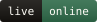
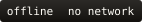
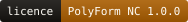
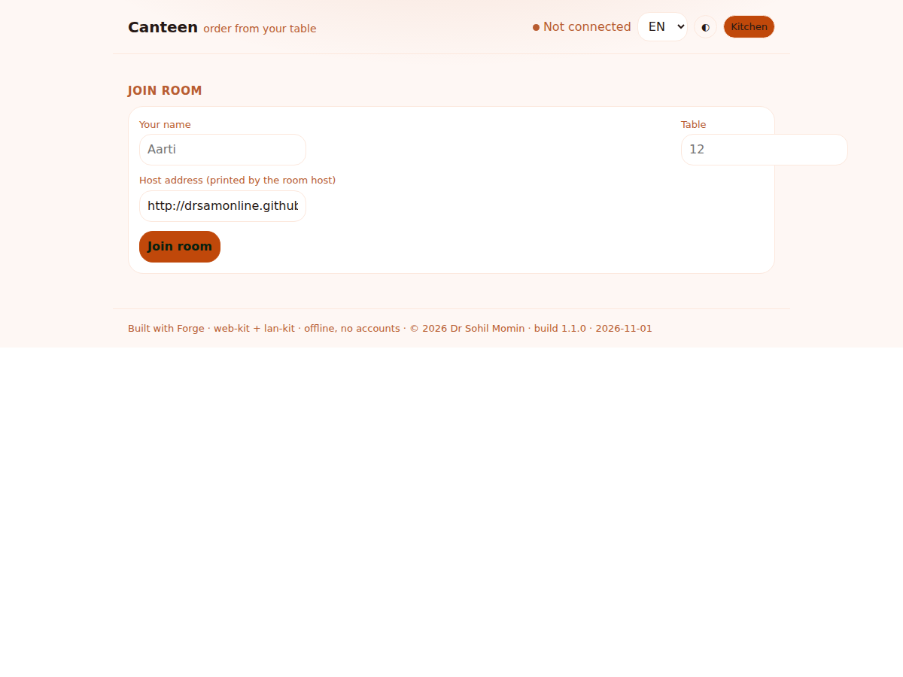
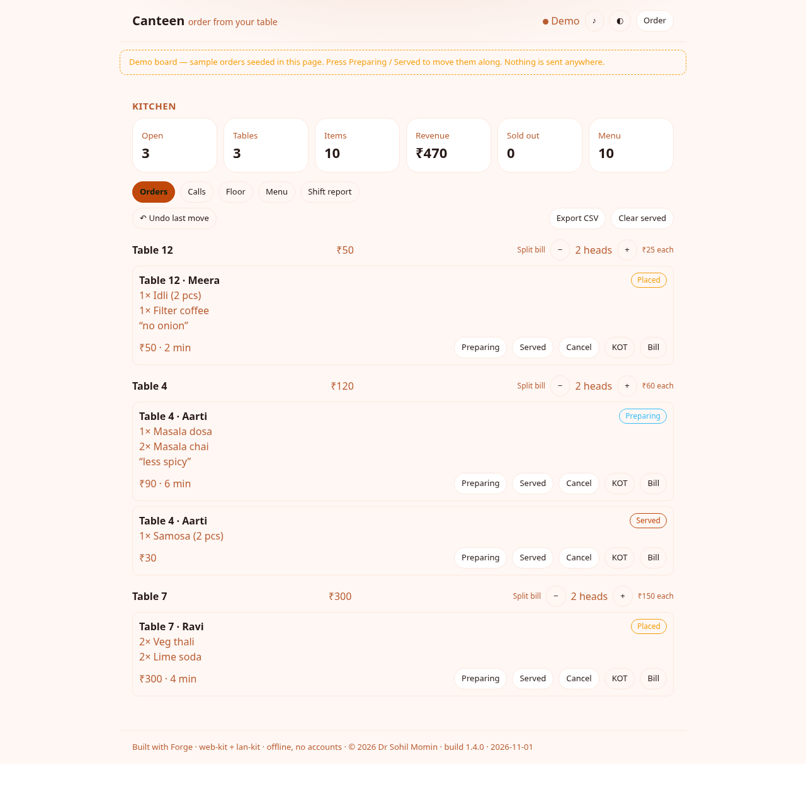

# Canteen LAN

[](https://drsamonline.github.io/canteen-lan/)
[](test-node.js)
[](docs/play/)
[](#what-it-refuses-to-do)
[](LICENSE)
[](docs/play/canteen.js)

**Order from your table over the room's own Wi-Fi.** One laptop hosts the canteen and
serves the board itself; every phone on the network joins it, orders from its seat, and
the kitchen watches each table move from *placed* to *served*. No internet, no accounts,
no telemetry, no dependency at runtime — and the board speaks English, one language, so
nothing can drift out of sync with itself.

**[Open the board](https://drsamonline.github.io/canteen-lan/play/)** ·
**[The landing page](https://drsamonline.github.io/canteen-lan/)** ·
**[Run a room](#run-a-room)** ·
**[Adding a menu item](#adding-a-menu-item)** ·
**[Licence](LICENSE)**

<!-- shot:start -->



<!-- shot:end -->



## What it does

A guest picks a table and a name, searches or filters the menu, picks **priced modifiers**
(*Elaichi +₹5*), adds items to a cart that survives a reload, and places the order with a
note — then taps *Show my bill* for an itemised slip with a QR the counter can read. The
kitchen sees every open order grouped by table with the running bill and the minutes each
has waited, or as a **floor** of tiles it can tap; marks one *preparing*, *served* or
*cancelled*, **undoes** a wrong tap, **splits a table's bill** across heads in exact paise,
prints a KOT or bill, edits the menu with its **stock counts**, **modifiers** and
**serving windows**, prints the **menu board for the wall** on A3, reads the **shift
report** — as a screen or an **A4 sheet** — and exports the day as CSV. The shift downloads
as a file and can be put back from the board, so a backup needs no shell.

It keeps working when the Wi-Fi does not: a service worker holds the shell, and anything
sent while the room is unreachable waits in an outbox and is re-sent on reconnect — with
idempotent order ids, so a re-send can never double-charge a table.

The landing page embeds the real board in a frame (`play/?demo=1`) seeded with a shift's
worth of orders, so you can move an order along, open the menu editor and add a dish
before you install anything. The demo runs the same code as the app, from a pure engine
function (`Canteen.demoDoc()`) the tests cover — there is no second demo build.

## Adding a menu item

Three ways in, all ending in one `menu` message every device applies. There is no admin
panel to log into and no database to migrate.

1. **From the board.** Kitchen → *Menu* → name, price in rupees, optional SKU and tags →
   *Save item*. It appears on every phone at once. Edit, *Sold out* and *Delete* sit on
   the same row.
2. **At startup, from a file.** `node host/room.js --menu my-menu.json` — a JSON array of
   `{ "sku", "name", "price", "tags", "names" }`, price in **paise**. Once the room has
   run, the journal wins, so a kitchen edit is never overwritten by a restart.
3. **By protocol.** `{ t: "menu:set", item: {…} }`, with `menu:del` and `menu:sold`
   beside it. SKUs, prices and tags are re-validated on arrival, so a hostile peer cannot
   post a ₹1 thali.

Two rules make it safe to edit a live board: a placed order keeps the name and price it
was ordered at, so changing the menu never rewrites an old bill; and a sold-out item
leaves the guest menu while staying on the bills already open.

A dish can carry **priced modifiers** (`Extra chutney:10, No sugar:0`, set as `name:price`
pairs) and a **serving window** (`from` 6, `to` 11 — it may wrap past midnight). The guest
menu follows the clock and says how many dishes are off it at this hour; the window is a
display rule, so an order already placed is never re-priced or refused by the clock. A
modifier's price always comes from the dish's own list, never from the message, so a peer
on the LAN cannot price its own extra.

A dish can also carry a **count** — twelve thalis, not "sold out". An order can only be
placed as far as the count goes, the count comes off the menu as the order goes on the
board (so a replay of the same messages lands on the same numbers), and at zero the dish
leaves the guest menu while staying on open bills. `{ t: "stock:set", sku, stock }` sets
it; a blank count means unlimited.

## Run a room

One machine — a laptop, a Pi, anything with Node:

```
node host/room.js                            # room "canteen", port 8080
node host/room.js --pin 4821                 # a stranger on the Wi-Fi is refused
node host/room.js --print 192.168.1.50:9100  # every order prints a KOT
node host/room.js --menu my-menu.json        # seed the menu
node host/room.js --data .canteen            # where the journal lives
node host/room.js --mirror 192.168.1.21:8080 # keep a second host in step
```

`--mirror` forwards every broadcast to a peer host, so the counter keeps running if the
laptop dies; forwarded messages are marked and never re-forwarded, so two hosts cannot
loop at each other. `--mirror-pin` is for a peer that does not share the room's PIN.

It serves the board itself at `/`, prints the LAN address, and draws a QR in the terminal
for a guest to scan — the code carries the room PIN, so scanning joins in one step. Also on
offer: `/join` (a scannable page), `/qr.svg`, `/state`, `/report`, `/print`, and `/journal`
(GET the shift as a `.jsonl`, POST it back to restore).

The journal is `.canteen/room-<room>.jsonl` — one JSON object per message. A restart
replays the shift instead of losing it, and the menu comes back as the kitchen left it.

```
node test-node.js             # 247 passed — engine, transport, page
node scripts/smoke-host.js    # 29 passed — the real host, across a restart and a mirror
node scripts/link-check.js    # 34 passed — every local link and anchor resolves
```

No host at all? `docs/play/index.html?solo=1` runs the whole canteen on one device, with
the board persisted locally.

## How it is built

The app is thin on purpose, and every part it stands on is **in the repository**:

- `docs/play/canteen.js` — the engine: the board (menu, orders, table calls, audit log) and
  the twelve-message protocol (`menu`, `menu:set`, `menu:del`, `menu:sold`, `stock:set`,
  `order`, `status`, `cancel`, `undo`, `clear`, `call`, `ack`), plus priced modifiers,
  serving windows, the floor plan, the bill slip and the split. Pure, zero-dependency, identical in the browser and under Node,
  so the whole mechanic is tested headlessly.
- `docs/play/web-kit.js` — the slice of the shared web-kit the app uses (storage, i18n
  EN/HI/GU, CSV, theme, seo, ui), shipped locally. It used to be *assumed* rather than
  shipped, which meant the page threw before it painted: 78 green engine tests and a dead
  screen. A test now reads `docs/play/index.html` and fails if any script it references is
  missing or remote.
- `docs/play/lan-kit.js` — the room transport: SSE for server→client, plain POST for
  client→server, with the optional room PIN riding on every POST.
- `docs/play/sw.js` + `manifest.webmanifest` — the offline shell: HTML network-first,
  assets cache-first, cache name bumped per release, and a build stamp in the footer so
  "am I on the new one?" is answerable from the page itself.
- `docs/play/index.html` — the menu, the cart, the join panel, the kitchen, the floor, the
  menu editor, the report (screen and A4) and the guest's slip. English only, by decision:
  one language is easier to keep honest than three, and it is the one the thermal roll can
  print. The engine still stores an optional `names` field, so a Hindi board would be a UI
  job later rather than a data migration.
- `host/lan-host.js` — the room: SSE, POST, a PIN check, the journal (including `/journal`
  download and restore), an optional mirror, and static serving.
- `host/room.js` — the canteen host: journal replay, `/join`, `/qr.svg`, `/state`,
  `/report`, `/print`, and a KOT to a thermal printer on every order.
- `docs/play/qr.js` — a real QR encoder (byte mode, versions 1–4, ECC L): bit stream,
  Reed–Solomon parity, function patterns, mask chosen by penalty score. It lives in the app
  folder because two surfaces need it — the host's join code and the guest's bill slip —
  and `host/qr.js` is the Node door to the same file. `scripts/qr-verify.py` checks the
  finished matrix module-for-module against the reference `qrcode` library — 4/4 exact —
  because a hand-rolled encoder is exactly the code that looks right and scans wrong.
- `host/print.js` — ESC/POS over a TCP socket, 32 columns, no driver and no CUPS.
- `scripts/smoke-host.js` — starts `host/room.js` as a real process, drives its routes
  over HTTP, kills it, starts it again and checks the shift and the menu came back, then
  brings a mirror up beside it and round-trips the journal.
- `scripts/link-check.js` — every relative link, image and in-page anchor on the landing
  page and the README resolves; it runs in CI, so a renamed file cannot break a badge
  quietly.

Every message is sanitised on arrival (SKUs, quantities, tables, statuses, tags, languages
and calls are validated and clamped) and **prices are taken from the room's menu, never
from the message**, so a buggy or hostile peer on the LAN cannot mis-price an order or
break the board. Money is integer paise, so a running bill never drifts — including a bill
split seven ways.

The landing page at `docs/index.html` is its own object — a kitchen pass of thermal tickets
and hairline rules on butcher paper, deliberately unlike the app's rounded, warm interface.
Its badges are generated locally by `scripts/badges.py`; nothing on either surface is
fetched from an image service or a CDN.

## What it refuses to do

No cloud, no accounts, no internet, no telemetry, no CDN or external font, no app store, no
runtime dependency, no database or migrations, no printer driver — and no price that came
off the wire.

## Build the EXE and APK

On every push, GitHub Actions runs the suite, builds a portable Windows EXE and a signed
Android APK from `docs/play`, publishes them to the `app-latest` release with the app icon
attached, and deploys the demo to Pages. All from the same commit, so the live demo and the
download can never disagree.

## Licence

PolyForm Noncommercial 1.0.0 — see [LICENSE](LICENSE).
Required Notice: Copyright 2026 Dr Sohil Momin. Part of the Forge system — apps open,
orchestrator licensed.
